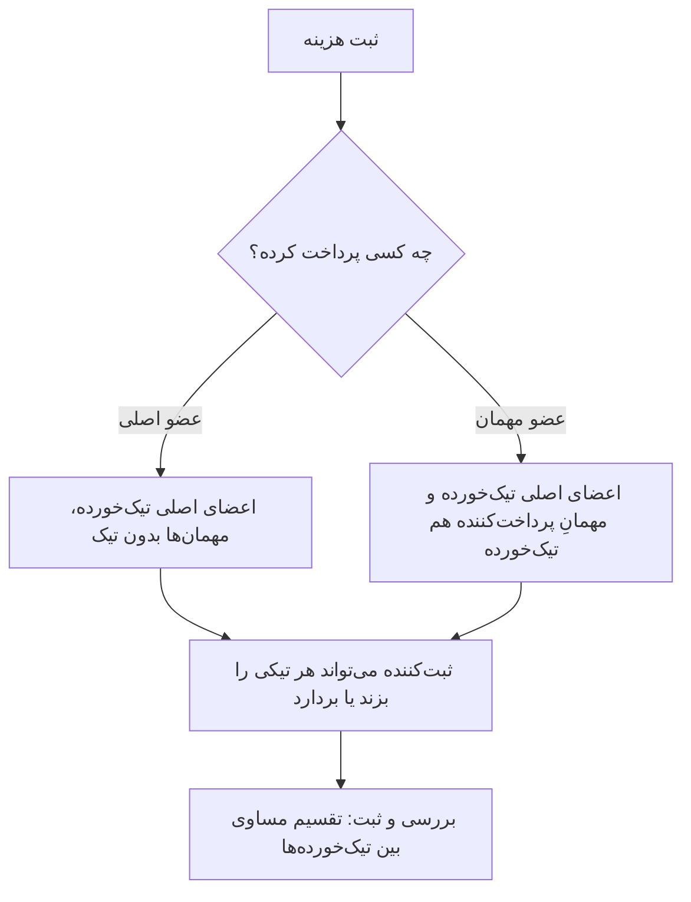
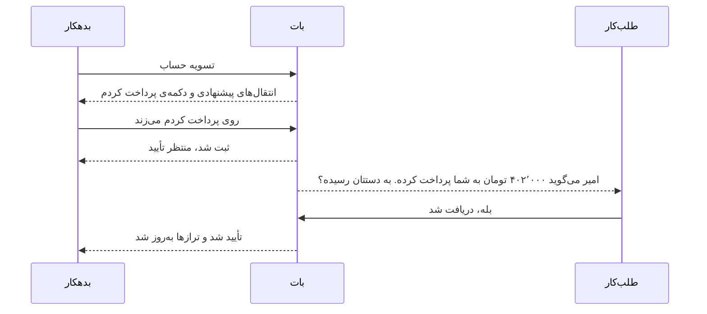
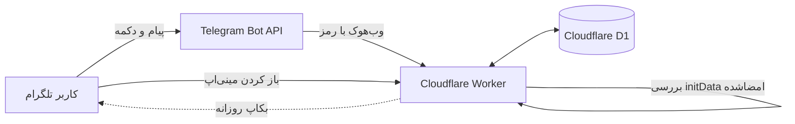

<div dir="rtl">

<p align="center"></p>

<h1 align="center">DormLedger (دفتر خوابگاه)</h1>

<p align="center"><b>تقسیم عادلانه‌ی هزینه‌های خوابگاه، دیدن بدهی‌ها و تسویه‌ی حساب؛ مستقیم داخل تلگرام.</b></p>

<p align="center">
<a href="https://github.com/alireza-yahyae/dormledger/actions/workflows/ci.yml"></a>


</p>

<p align="center"><a href="README.md">English</a> &nbsp;·&nbsp; <a href="#install">نصب</a> &nbsp;·&nbsp; <a href="#whats-new">تازه‌ها</a> &nbsp;·&nbsp; <a href="#screenshots">تصاویر</a> &nbsp;·&nbsp; <a href="#guests">اعضای مهمان</a> &nbsp;·&nbsp; <a href="#commands">دستورها</a> &nbsp;·&nbsp; <a href="#faq">رفع مشکل</a></p>

دورم‌لجر یک **بات + مینی‌اپ تلگرام** برای هم‌اتاقی‌هاست. هر کس خرجش را ثبت می‌کند، برنامه ترازها را دقیق نگه می‌دارد و پیشنهاد می‌دهد چه کسی چقدر به چه کسی بدهد تا حساب‌ها با کمترین تعداد انتقال صفر شود. کد با TypeScript نوشته شده، **هیچ وابستگی زمان اجرا ندارد** و روی پلن رایگان کلودفلر (Workers و D1) و در **حساب خودت** اجرا می‌شود؛ هیچ سروری از طرف من وسط کار نیست. رابط کاربری فارسی (راست‌به‌چپ) با تم تیره و روشن است.

<a id="install"></a>

## نصب با یک خط

**PowerShell** را باز کن و این را بچسبان:

```powershell
irm https://raw.githubusercontent.com/alireza-yahyae/dormledger/main/scripts/install.ps1 | iex
```

همین. نصب‌کننده چند سؤال کوتاه می‌پرسد، یک بار مرورگرت را برای ورود به کلودفلر باز می‌کند و در پایان یک بات کارا تحویل می‌دهد:

| # | چه اتفاقی می‌افتد | تو چه می‌کنی |
|---|---|---|
| ۱ | Node.js نسخه‌ی ۲۲٫۱۳ به بالا و Git را بررسی می‌کند و پیشنهاد می‌دهد با `winget` نصبشان کند | Enter |
| ۲ | پروژه را دانلود می‌کند، `npm install` و تست‌ها را اجرا می‌کند | - |
| ۳ | وارد کلودفلر می‌شود (`wrangler login`) | در مرورگر **Allow** را بزن |
| ۴ | توکن بات را می‌خواهد و با تلگرام امتحانش می‌کند | از [@BotFather](https://t.me/BotFather) یک بات بساز و توکن را بچسبان |
| ۵ | دیتابیس D1 را می‌سازد، `wrangler.jsonc` را می‌نویسد و مایگریشن‌ها را اجرا می‌کند | - |
| ۶ | Worker را منتشر می‌کند، رمزها را ذخیره می‌کند و وب‌هوک و دکمه‌ی منو و دستورها را به تلگرام وصل می‌کند | - |

وقتی نوشت **DONE**، بات را در تلگرام باز کن، **Start** بزن، یک اتاق بساز و کد دعوت را برای بقیه بفرست.

**به‌روزرسانی** هم همین خط است. اول از دیتابیس‌ات یک نسخه‌ی پشتیبان می‌گیرد، کد جدید را می‌گیرد، مایگریشن‌های تازه را اجرا و منتشر می‌کند و منوی بات را تازه می‌کند. داده‌ها و رمزهایت می‌مانند.

<details>
<summary><b>گزینه‌ها، ایمنی و اینکه دقیقاً چه می‌کند</b></summary>

<br>

*می‌خواهی اول بخوانیش؟* کار درستی است؛ فقط یک فایل متنی ساده است: [`scripts/install.ps1`](scripts/install.ps1).

```powershell
irm https://raw.githubusercontent.com/alireza-yahyae/dormledger/main/scripts/install.ps1 -OutFile install.ps1
notepad install.ps1                 # بخوانش
powershell -ExecutionPolicy Bypass -File .\install.ps1
```

اگر می‌خواهی پیش‌فرض‌ها را عوض کنی، این متغیرها را **قبل از** خط نصب بگذار:

| متغیر | معنی | پیش‌فرض |
|---|---|---|
| `DORMLEDGER_DIR` | پوشه‌ی نصب | `~\dormledger` |
| `DORMLEDGER_NAME` | نام Worker و دیتابیس | `dormledger` |
| `DORMLEDGER_BOT_TOKEN` | توکن بات (سؤال را رد می‌کند) | پرسیده می‌شود |
| `DORMLEDGER_BACKUP_CHAT_ID` | آیدی عددی تلگرامی که بکاپ روزانه را می‌گیرد | ندارد |
| `DORMLEDGER_YES=1` | به سؤال‌های معمولی «بله» می‌دهد (سؤال‌های پرخطر باز هم می‌ایستند) | می‌پرسد |
| `DORMLEDGER_REPO` و `DORMLEDGER_BRANCH` | نصب یک فورک یا شاخه‌ی دیگر | همین مخزن و `main` |

```powershell
$env:DORMLEDGER_DIR = 'D:\bots\dormledger'
irm https://raw.githubusercontent.com/alireza-yahyae/dormledger/main/scripts/install.ps1 | iex
```

چه کارهایی را **نمی‌کند:** هرگز `exit` نمی‌زند (پنجره‌ات بسته نمی‌شود)، توکن بات را روی دیسک نمی‌نویسد (رمزها از یک فایل موقت که فوراً پاک می‌شود به کلودفلر می‌روند)، به چیزی بیرون از پوشه‌ی نصب و حساب کلودفلر خودت دست نمی‌زند و هر جا مشکل باشد با یک پیام ساده می‌ایستد. اگر وسط کار ایستاد همان خط را دوباره اجرا کن؛ از همان‌جا ادامه می‌دهد.

برای Windows PowerShell 5.1 (که توی ویندوز ۱۰ و ۱۱ هست) و PowerShell 7 نوشته شده است. متن‌های آن عمداً انگلیسی است تا در هر کنسولی درست نمایش داده شود.

</details>

<a id="whats-new"></a>

## تازه‌های نسخه‌ی ۲

- **تسویه داخل خودِ بات کار می‌کند.** دوستانی که هیچ‌وقت مینی‌اپ را باز نمی‌کنند هم می‌توانند در چت «تسویه حساب» را بزنند، بدهی‌شان را ببینند، روی **«پرداخت کردم»** بزنند و کسی که پول را گرفته پیامی با دکمه‌ی تأیید و رد می‌گیرد. (دکمه‌های قبلی را تلگرام بی‌صدا دور می‌ریخت؛ جزئیات در [CHANGELOG](CHANGELOG.md).)
- **عضو مهمان.** مدیر می‌تواند افرادی (حتی خودش) را «عضو مهمان» کند. این افراد هنگام ثبت هزینه تیک پیش‌فرض ندارند، مگر اینکه خودشان پرداخت‌کننده باشند. [توضیح کامل پایین‌تر.](#guests)
- **نصب‌کننده و به‌روزرسانِ یک‌خطی برای PowerShell** (بالا).
- **ابزار انتشار روی گیت‌هاب** ([`scripts/release_to_github.py`](scripts/release_to_github.py)): با ورود از مرورگر پروژه را روی گیت‌هاب می‌گذارد، نسخه را برچسب می‌زند و Release می‌سازد.
- **README و تصاویر تازه**، از جمله چت بات. تصاویر از روی کد واقعی و با داده‌ی ساختگی ساخته شده‌اند.

## امکانات

- **اتاق و اعضا:** چند اتاق برای هر نفر، کد دعوت، افزودن عضو با آیدی تلگرام (برایش درخواست می‌رود و فقط **بعد از قبول کردنِ خودش** عضو می‌شود) یا بدون تلگرام (بعداً می‌پیوندد)، ترک اتاق توسط خود عضو، نقش‌ها (مدیر اصلی / مدیر / عضو) و نام مستعار.
- **مبلغ دقیق:** مبلغ‌ها تا **۲ رقم اعشار** پشتیبانی می‌شوند و به‌صورت عدد صحیح ذخیره می‌شوند؛ پس ۱۰۰ تقسیم بر ۳ همیشه می‌شود ۳۳٫۳۴ و ۳۳٫۳۳ و ۳۳٫۳۳.
- **تقسیم مساوی یا دلخواه:** شرکای هر هزینه را انتخاب کن یا سهم هر نفر را بنویس.
- **اعضای مهمان:** کادری جدا برای کسانی که به‌طور پیش‌فرض تیک ندارند.
- **تراز و تسویه:** تراز زنده‌ی هر عضو و **کمترین تعداد انتقال ممکن** برای صفر کردن حساب‌ها (گروه‌های مستقل جدا از هم تسویه می‌شوند). گزینه‌ی اختیاری **گرد کردن** مبلغ پیشنهادی به ۱۰۰۰ تومان برای هر اتاق؛ ترازهای واقعی دقیق می‌مانند.
- **تأیید طلب‌کار (اختیاری):** برای هر اتاق مشخص می‌شود پرداخت باید توسط طلب‌کار تأیید شود یا فوراً اعمال شود.
- **اعلان:** با ثبت هر هزینه، همه‌ی افراد درگیر پیامی با سهم خودشان می‌گیرند.
- **ویرایش هزینه:** تغییر مبلغ، پرداخت‌کننده، سهم‌ها و تاریخ با پیش‌نمایش تغییر ترازها. ویرایش‌های قدیمی رد می‌شوند و پرداخت‌های در انتظارِ ناسازگار خودکار لغو می‌شوند.
- **پاک کردن تاریخچه با امکان برگشت:** مدیر می‌تواند همه‌ی سوابق را پاک کند؛ تا **۴۸ ساعت** قابل بازگردانی است.
- **گزارش:** نمودار ماهانه، دسته‌بندی، جستجو و فیلتر، خروجی CSV.
- **بکاپ روزانه:** یک فایل SQL فشرده و یک گزارش CSV خوانا به چت تلگرامت فرستاده می‌شود و/یا در باکت R2 ذخیره می‌شود ([بکاپ](#بکاپ)).
- **امن:** اعتبارسنجی امضای تلگرام (`initData`)، ثبت تکرارناپذیر (idempotent)، لاگ تغییرات و رمز وب‌هوک.
- **در خود چت هم کار می‌کند:** همه‌ی کارهای اصلی با دستور و دکمه‌ی بات هم در دسترس است.

<a id="screenshots"></a>

## تصاویر

### مینی‌اپ

<table>
  <tr>
    <td align="center" width="25%"><br><sub><b>خانه</b><br>تراز تو و این ماه</sub></td>
    <td align="center" width="25%"><br><sub><b>هزینه‌ها</b><br>جستجو، فیلتر و دسته‌بندی</sub></td>
    <td align="center" width="25%"><br><sub><b>تسویه حساب</b><br>کمترین تعداد انتقال</sub></td>
    <td align="center" width="25%"><br><sub><b>اعضا</b><br>اعضای اصلی و مهمان</sub></td>
  </tr>
  <tr>
    <td align="center"><br><sub><b>هزینه‌ی تازه</b><br>مهمان‌ها در کادر جدا و بدون تیک</sub></td>
    <td align="center"><br><sub><b>مهمان پرداخت کرده</b><br>پس تیکش خودکار خورده</sub></td>
    <td align="center"><br><sub><b>جزئیات</b><br>چه کسی داده، سهم هر نفر</sub></td>
    <td></td>
  </tr>
</table>

### چت بات

<table>
  <tr>
    <td align="center" width="25%" valign="top"><br><sub><b>«تسویه حساب»</b><br>پیشنهادها و دکمه‌ی «پرداخت کردم»</sub></td>
    <td align="center" width="25%" valign="top"><br><sub><b>طلب‌کار تأیید می‌کند</b><br>با یک ضربه</sub></td>
    <td align="center" width="25%" valign="top"><br><sub><b>«ثبت هزینه»</b><br>اعضای اصلی تیک‌خورده، مهمان‌ها جدا</sub></td>
    <td align="center" width="25%" valign="top"><br><sub><b>/guests</b><br>مدیر مهمان‌ها را تعیین می‌کند</sub></td>
  </tr>
</table>

<sub>همه‌ی تصاویر از روی رابط و کد واقعی بات با آدم‌ها و مبلغ‌های ساختگی ساخته شده‌اند (هیچ داده‌ی واقعی‌ای نیست). برای ساختن دوباره‌شان بخش [توسعه](#توسعه) را ببین.</sub>

<a id="guests"></a>

## اعضای مهمان

بعضی‌ها فقط گاهی پیدایشان می‌شود. «مهمان» کردنشان آن‌ها را از انتخاب پیش‌فرض بیرون می‌برد؛ پس حالت رایج، یعنی تقسیم بین کسانی که همیشه آنجا هستند، دیگر نیاز به برداشتن تیک ندارد.

- مدیر (یا مدیر اصلی) هر عضو فعالی را، **حتی خودش را**، با دکمه‌ی «مهمان» در تب اعضا یا با `/guests` در بات، عضو مهمان می‌کند. دوباره بزنی دوباره عضو اصلی می‌شود.
- هنگام ثبت هزینه **اعضای اصلی تیک‌خورده‌اند** و **مهمان‌ها در یک کادر جدا و بدون تیک** هستند.
- استثنا: **مهمانی که خودش پرداخت‌کننده است، خودکار تیک می‌خورد** (اگر پول داده، در این هزینه سهم دارد).
- ثبت‌کننده‌ی هزینه هر تیکی را که بخواهد برمی‌دارد یا می‌زند؛ این فقط انتخاب *پیش‌فرض* است.
- هیچ‌وقت ترازها و هزینه‌های قبلی را عوض نمی‌کند.



## تسویه داخل چت

خودِ بدهکار دکمه را می‌زند، پس هیچ‌کس نمی‌تواند به جای دیگری پرداختی ثبت کند. اگر طلب‌کار هنوز تلگرامش را وصل نکرده باشد، مدیر می‌تواند به جای او تأیید یا رد کند.



## نصب دستی (هر سیستم‌عاملی)

پیش‌نیاز: حساب [کلودفلر](https://dash.cloudflare.com) (رایگان)، حساب تلگرام و [Node.js](https://nodejs.org) نسخه‌ی ۲۲٫۱۳ یا بالاتر.

```bash
git clone https://github.com/alireza-yahyae/dormledger.git
cd dormledger
npm install
npx wrangler login
```

1. **ساخت بات:** در تلگرام به [@BotFather](https://t.me/BotFather) پیام بده، `/newbot` را بزن و توکن را نگه دار.
2. **ساخت دیتابیس:** `npx wrangler d1 create dormledger` و `database_id` چاپ‌شده را کپی کن.
3. **تنظیمات:** فایل `wrangler.example.jsonc` را به `wrangler.jsonc` کپی کن و `database_id` و `APP_URL` (به شکل `https://dormledger.<ساب‌دامین-تو>.workers.dev`) را بنویس.
4. **ساخت جدول‌ها:** `npm run migrate:remote`
5. **ثبت رمزها:**
   ```bash
   npx wrangler secret put BOT_TOKEN        # توکن BotFather
   npx wrangler secret put WEBHOOK_SECRET   # یک رشته‌ی تصادفی بلند
   ```
6. **دیپلوی:** `npm run deploy`
7. **وصل کردن تلگرام:** این آدرس را یک بار در مرورگر باز کن (وب‌هوک، دکمه‌ی منو و دستورها را تنظیم می‌کند):
   ```
   https://dormledger.<ساب‌دامین-تو>.workers.dev/setup?key=<WEBHOOK_SECRET>
   ```
8. بات را در تلگرام باز کن، `/start` بزن و روی **🚀 باز کردن DormLedger** بزن.

> مینی‌اپ فقط از داخل تلگرام کار می‌کند، چون برای شناختن کاربر به `initData` امضاشده‌ی تلگرام نیاز دارد.

**به‌روزرسانی دستی:** `git pull && npm install` و بعد `npm run migrate:remote` (فقط مایگریشن‌های جدید اجرا می‌شود) و `npm run deploy`؛ اگر نسخه دستور تازه‌ای به بات اضافه کرده، آدرس `/setup?key=...` را هم یک بار باز کن. قبلش بکاپ بگیر: `npx wrangler d1 export dormledger --remote --output backup.sql` (اطلاعات واقعی کاربران است؛ در `.gitignore` هست و **هرگز کامیتش نکن**).

<a id="commands"></a>

## دستورهای بات

| دستور | کار |
|---|---|
| `/start` و `/app` | خوش‌آمد / باز کردن مینی‌اپ |
| `/add` | ثبت هزینه |
| `/balance` و `/settle` | تراز و انتقال‌های پیشنهادی (با دکمه‌های «پرداخت کردم») |
| `/expenses` و `/members` و `/rooms` | لیست‌ها |
| `/guests` | تعیین اعضای مهمان (مدیر) |
| `/addmember نام` | افزودن عضو بدون تلگرام (مدیر) |
| `/invite [عضو]` و `/join کد` | ساخت کد دعوت / پیوستن با کد |
| `/name` و `/nickname` | تغییر نام و نام مستعار |
| `/leave` | ترک اتاق فعلی (وقتی ترازت صفر است) |
| `/clearhistory` و `/restorehistory` | پاک کردن تاریخچه / بازگردانی تا ۴۸ ساعت (مدیر) |
| `/help` و `/cancel` | راهنما / انصراف |

## بکاپ

کرون روزانه (ساعت ۰۳:۱۷ UTC) از همه‌ی جدول‌های داده (بدون وضعیت موقت بات) یک فایل فشرده‌ی `INSERT` می‌سازد. یکی از مقصدها یا هر دو را فعال کن:

- **تلگرام:** در `wrangler.jsonc` مقدار `BACKUP_CHAT_ID` را برابر **آیدی عددی خودت** بگذار (از [@userinfobot](https://t.me/userinfobot) بگیر؛ باید یک بار بات را `/start` کرده باشی؛ نصب‌کننده هم می‌تواند این را برایت تنظیم کند). فایل‌ها به‌صورت document در همان چت می‌آیند. چون داده‌ی واقعی کاربرها در آن‌هاست، فقط چت خصوصی بگذار. هر روز دو فایل می‌رسد: `.sql.gz` برای بازگردانی و یک `-report.csv` (تراز، همه‌ی هزینه‌ها و پرداخت‌های تأییدشده) که روی گوشی با گوگل‌شیت یا اکسل باز می‌شود و به بات نیازی ندارد.
- **باکت R2:** `npx wrangler r2 bucket create dormledger-backups` را بزن و بلوک `r2_buckets` را در `wrangler.jsonc` از حالت کامنت دربیاور. هر روز یک فایل ذخیره می‌شود و `BACKUP_KEEP` فایل آخر (پیش‌فرض ۱۴) نگه داشته می‌شود.
- **بات دوم (پیشنهادی):** در @BotFather یک بات دیگر بساز، یک بار رویش Start بزن و بعد `npx wrangler secret put BACKUP_BOT_TOKEN` را اجرا کن. بکاپ‌ها با همان بات فرستاده می‌شوند و اگر بات اصلی بن یا باطل شود، بکاپ‌ها قطع نمی‌شوند.

اگر یکی از مقصدها خطا بدهد در تلگرام هشدار می‌گیری. با فرستادن `/backup` به بات از حساب `BACKUP_CHAT_ID` می‌توانی همین حالا بکاپ بگیری (این دستور برای بقیه پنهان است).

**اگر بن شدم چه می‌ماند؟** هرچه قبلاً به چتت رسیده. کرون روی کلودفلر اجرا می‌شود؛ پس اگر خودِ حساب کلودفلر بسته شود بکاپ *جدیدی* ساخته نمی‌شود (حداکثر یک روز آخر از دست می‌رود). فایل‌ها را گاهی به *Saved Messages* تلگرام فوروارد کن (مستقل از هر بات) یا روی گوشی نگه دار.

**بازگردانی:** یک دیتابیس بساز، مایگریشن‌ها را اجرا کن و بعد فایل را اجرا کن:

```bash
gunzip dormledger-2026-10-14.sql.gz
npx wrangler d1 create dormledger-restored      # database_id را در wrangler.jsonc بگذار
npx wrangler d1 migrations apply dormledger-restored --remote
npx wrangler d1 execute dormledger-restored --remote --file=dormledger-2026-10-14.sql
```

## امنیت و حریم خصوصی

- داده‌هایت در دیتابیس D1 **خودت** روی کلودفلر می‌ماند. پروژه فقط با تلگرام و کلودفلر حرف می‌زند؛ نصب‌کننده هیچ‌چیز را جای دیگری نمی‌فرستد.
- رمزها (`BOT_TOKEN` و `WEBHOOK_SECRET`) به‌صورت secret کلودفلر ذخیره می‌شوند، نه در مخزن. `wrangler.jsonc` و `.dev.vars` و `.env*` و خروجی‌های دیتابیس در `.gitignore` هستند و ابزار انتشار از آپلود آن‌ها و هر چیزی که شبیه توکن باشد خودداری می‌کند.
- هر درخواست API با `initData` امضاشده‌ی تلگرام احراز هویت می‌شود؛ وب‌هوک فقط درخواستی را که رمز تو را دارد می‌پذیرد؛ کارهایی که پول را عوض می‌کنند تکرارناپذیرند و در لاگ ثبت می‌شوند.
- آسیب‌پذیری پیدا کردی؟ [SECURITY.md](SECURITY.md) را ببین.

<a id="faq"></a>

## پرسش‌های پرتکرار و رفع مشکل

<details>
<summary><b>هزینه‌ای دارد؟</b></summary>
یک اتاق هم‌خانه‌ای بخش ناچیزی از پلن رایگان کلودفلر (Workers و D1) را مصرف می‌کند و برای پلن رایگان کارت بانکی لازم نیست. بات تلگرام هم رایگان است.
</details>

<details>
<summary><b>PowerShell می‌گوید «running scripts is disabled on this system»</b></summary>
این فقط برای یک فایل <code>.ps1</code> دانلودشده است. فرمان یک‌خطی (<code>irm ... | iex</code>) بسته نمی‌شود. برای فایل ذخیره‌شده بزن: <code>powershell -ExecutionPolicy Bypass -File .\install.ps1</code>
</details>

<details>
<summary><b>«Node.js 22.13 or newer is needed»</b></summary>
نصب‌کننده پیشنهاد می‌دهد آخرین نسخه‌ی LTS را با winget نصب کند. اگر winget نبود، Node.js LTS را از nodejs.org نصب کن، یک پنجره‌ی <b>تازه</b> PowerShell باز کن و همان خط را دوباره بزن.
</details>

<details>
<summary><b>کلودفلر ساب‌دامین workers.dev می‌خواهد</b></summary>
فقط بار اول روی حساب تازه. هر اسمی بنویس؛ بخشی از آدرس برنامه‌ات می‌شود (<code>dormledger.&lt;اسم&gt;.workers.dev</code>).
</details>

<details>
<summary><b>نصب‌کننده نتوانست تلگرام را وصل کند («not reachable yet»)</b></summary>
آدرس تازه‌ی workers.dev گاهی یک دقیقه طول می‌کشد تا در دسترس شود. همان خط را دوباره بزن؛ فقط گام‌های آخر را تکرار می‌کند و وب‌هوک را تازه می‌کند.
</details>

<details>
<summary><b>مینی‌اپ می‌گوید باید از تلگرام باز شود</b></summary>
در تب معمولی مرورگر همین انتظار می‌رود. بات را باز کن و از دکمه‌ی منو یا <code>/app</code> استفاده کن.
</details>

<details>
<summary><b>به‌روزرسانی کردم ولی در منوی بات <code>/guests</code> نیست</b></summary>
خط نصب‌کننده را دوباره اجرا کن (منو را تازه می‌کند)، یا اگر دستی دیپلوی می‌کنی یک بار آدرس <code>https://&lt;آدرس-برنامه&gt;/setup?key=&lt;WEBHOOK_SECRET&gt;</code> را باز کن.
</details>

<details>
<summary><b>چطور همه‌چیز را پاک کنم؟</b></summary>
داخل پوشه‌ی نصب: <code>npx wrangler delete</code> و <code>npx wrangler d1 delete dormledger</code> و بعد پوشه را پاک کن. اگر بات را هم می‌خواهی حذف کنی، در تلگرام به @BotFather پیام <code>/deletebot</code> بده. اگر ممکن است دادهات را لازم داشته باشی اول خروجی بگیر.
</details>

## چطور کار می‌کند



Worker مینی‌اپ (یک صفحه‌ی HTML)، یک API کوچک JSON و وب‌هوک بات را سرو می‌کند. همه‌ی وضعیت در D1 است. منطق پول توابع خالص در `src/domain/` است و با تست پوشش داده شده، از جمله یک تست تصادفی که ثابت می‌کند «مجموع ترازها همیشه صفر است».

```
src/
  index.ts        مسیرها: مینی‌اپ، /api/*، /webhook، /setup، کرون
  api.ts          API مینی‌اپ
  bot.ts          منطق بات و اعلان‌ها
  security.ts     اعتبارسنجی initData تلگرام
  backup.ts       بکاپ روزانه‌ی SQL و CSV به تلگرام / R2
  domain/         پول، تقسیم، دفتر، تسویه (خالص و تست‌شده)
  ui.ts           ساخته‌شده از ui/index.html  (npm run build:ui)
ui/index.html     مینی‌اپ (یک فایل، بدون ابزار ساخت)
migrations/       مایگریشن‌های شماره‌دار D1 (مایگریشن منتشرشده را هرگز ویرایش نکن)
scripts/          install.ps1، release_to_github.py، build-ui.mjs، screenshots/
tests/unit/       تست‌های node:test (API، بات، رابط، دامنه، بکاپ)
```

## توسعه

```bash
npm test            # بدون نیاز به نصب وابستگی؛ از تست‌ران و SQLite داخلی Node استفاده می‌کند
npm run build:ui    # بعد از ویرایش ui/index.html
```

ساختن دوباره‌ی تصاویر README (نیاز به `pip install playwright` و یک Chromium برای آن):

```bash
node --experimental-strip-types --no-warnings scripts/screenshots/build_sample.mjs
node --experimental-strip-types --no-warnings scripts/screenshots/capture_bot.mjs
python scripts/screenshots/shoot.py
```

انتشار نسخه‌ی خودت یا نسخه‌ی تازه روی گیت‌هاب (ورود با مرورگر، برچسب و Release؛ اول با `--dry-run` امتحان کن):

```bash
python scripts/release_to_github.py --repo <نام-کاربری>/dormledger
```

## مشارکت

مسئله (Issue) و درخواست ادغام (Pull Request) خوشحالمان می‌کند؛ [CONTRIBUTING.md](CONTRIBUTING.md) و [CHANGELOG](CHANGELOG.md) را ببین.

## مجوز

[MIT](LICENSE)

</div>
