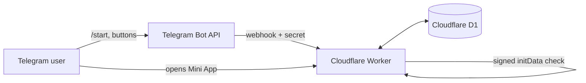

<div align="center">


# DormLedger

**Split dorm expenses fairly, see who owes whom, and settle up — right inside Telegram.**

[](../../actions/workflows/ci.yml)


[فارسی](README.fa.md) · [English](#features)

</div>

DormLedger is a self-hosted **Telegram bot + Mini App** for roommates. Everyone adds what they paid, the app keeps exact balances, and suggests the transfers that settle everything. It is written in TypeScript, has **no runtime dependencies**, and runs entirely on Cloudflare's free tier (Workers + D1). The interface is Persian (RTL) with dark/light themes.

## Features

- **Rooms & members** – several rooms per person, invite codes, add members by Telegram ID or without Telegram (they join later), roles (owner / admin / member), optional nicknames.
- **Exact money** – amounts support **2 decimal places** and are stored as integers (hundredths), so `100 ÷ 3` is always `33.34 + 33.33 + 33.33`, never `99.99`.
- **Equal or custom splits** – pick who shared an expense, or enter each person's share.
- **Balances & settlements** – a live balance per member and a suggested set of transfers that zeroes everything.
- **Optional creditor confirmation** – per room: either the person owed must confirm a payment, or it is applied immediately.
- **Edit expenses** – change amount, payer, split, date… with a before → after balance preview. Stale edits are rejected (optimistic versioning) and pending payments that no longer fit are cancelled automatically.
- **Clear history with undo** – admins can wipe all records; everything stays restorable for **48 hours**, then is purged for good.
- **Reports** – monthly chart, category breakdown, search & filters, CSV export.
- **Safe by design** – Telegram-signed `initData` validation, idempotent writes, an audit log, and a bot webhook secret.
- **Works in the chat too** – every main action is available as a bot command / button.

## Screenshots

<p align="center">
  
  
  
  
  
</p>

<sub>Screenshots are rendered from the real UI with sample data (no real people or amounts).</sub>

## How it works



The Worker serves the Mini App (one HTML page), a small JSON API, and the bot webhook. All state lives in D1. Money logic is pure functions in `src/domain/` and is covered by tests, including a randomized "balances always sum to zero" property test.

## Deploy your own

You need: a [Cloudflare](https://dash.cloudflare.com) account (free), a Telegram account, and [Node.js](https://nodejs.org) 22.13+.

```bash
git clone https://github.com/alireza-yahyae/dormledger.git
cd dormledger
npm install
npx wrangler login
```

1. **Create the bot** – talk to [@BotFather](https://t.me/BotFather), send `/newbot`, and keep the token.
2. **Create the database** – `npx wrangler d1 create dormledger` and copy the printed `database_id`.
3. **Configure** – copy `wrangler.example.jsonc` to `wrangler.jsonc` and fill in `database_id` and `APP_URL` (`https://dormledger.<your-subdomain>.workers.dev`).
4. **Create the tables** – `npm run migrate:remote`
5. **Set the secrets**
   ```bash
   npx wrangler secret put BOT_TOKEN        # token from BotFather
   npx wrangler secret put WEBHOOK_SECRET   # any long random string
   ```
6. **Deploy** – `npm run deploy`
7. **Connect Telegram** – open once in a browser (this sets the webhook, menu button and command list):
   ```
   https://dormledger.<your-subdomain>.workers.dev/setup?key=<WEBHOOK_SECRET>
   ```
8. Open your bot in Telegram, send `/start`, and tap **🚀 باز کردن DormLedger**.

> The Mini App only works from inside Telegram – it needs Telegram's signed `initData` to know who you are.

### Updating

```bash
git pull && npm install
npm run migrate:remote   # applies only new migrations
npm run deploy
```

Back up before big upgrades: `npx wrangler d1 export dormledger --remote --output backup.sql` (the file contains real user data – it is git-ignored, never commit it).

## Bot commands

| Command | What it does |
|---|---|
| `/start`, `/app` | Welcome / open the Mini App |
| `/add` | Record an expense |
| `/balance`, `/settle` | Balances and suggested transfers |
| `/expenses`, `/members`, `/rooms` | Lists |
| `/name`, `/nickname` | Change your display name / nickname |
| `/clearhistory`, `/restorehistory` | Clear all records / undo within 48 h (admins) |
| `/help`, `/cancel` | Help / cancel the current step |

## Project layout

```
src/
  index.ts        routes: Mini App, /api/*, /webhook, /setup, cron cleanup
  api.ts          JSON API for the Mini App
  bot.ts          Telegram bot logic and notifications
  security.ts     Telegram initData validation
  domain/         money, allocation, ledger, settlement (pure, tested)
  ui.ts           generated from ui/index.html  (npm run build:ui)
ui/index.html     the Mini App (single file, no build tools)
migrations/       numbered D1 migrations
tests/unit/       node:test suites (API, bot, UI smoke test, domain)
```

## Development

```bash
npm test            # no dependencies needed, uses Node's built-in test runner and SQLite
npm run build:ui    # after editing ui/index.html
```

## Contributing & security

See [CONTRIBUTING.md](CONTRIBUTING.md) and [SECURITY.md](SECURITY.md).

## License

[MIT](LICENSE)
