<div align="center">

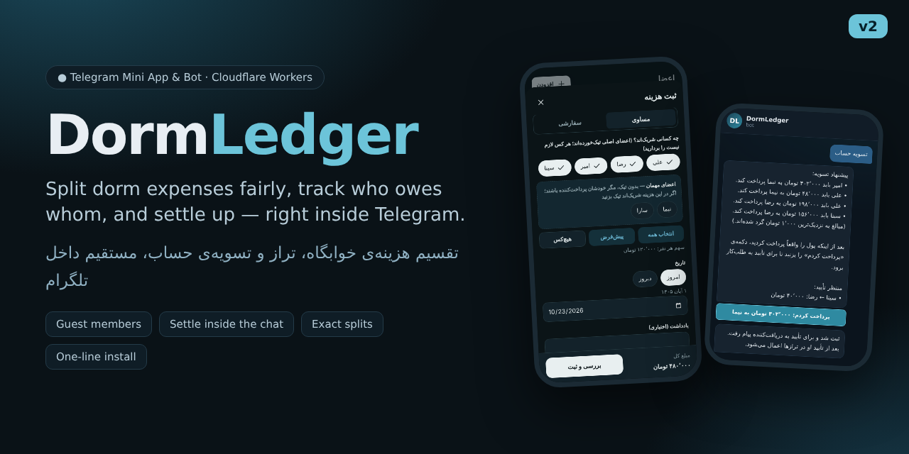

# DormLedger

**Split dorm expenses fairly, see who owes whom, and settle up - right inside Telegram.**

[](https://github.com/alireza-yahyae/dormledger/actions/workflows/ci.yml)


[فارسی](README.fa.md) &nbsp;·&nbsp; [Install](#install-in-one-line) &nbsp;·&nbsp; [What's new](#whats-new-in-v2) &nbsp;·&nbsp; [Screenshots](#screenshots) &nbsp;·&nbsp; [Guest members](#guest-members) &nbsp;·&nbsp; [Commands](#bot-commands) &nbsp;·&nbsp; [FAQ](#faq--troubleshooting)

</div>

DormLedger is a self-hosted **Telegram bot + Mini App** for roommates. Everybody adds what they paid, the app keeps exact balances, and it proposes the fewest transfers that settle everything. It is written in TypeScript, has **no runtime dependencies**, and runs on Cloudflare's free tier (Workers + D1) in **your own account** - there is no server of mine in the middle. The interface is Persian (RTL) with dark and light themes.

## Install in one line

Open **PowerShell** and paste:

```powershell
irm https://raw.githubusercontent.com/alireza-yahyae/dormledger/main/scripts/install.ps1 | iex
```

That is the whole installation. The installer asks a few short questions, opens your browser once to sign in to Cloudflare, and ends with a working bot:

| # | What happens | You do |
|---|---|---|
| 1 | Checks Node.js 22.13+ and Git, offers to install them with `winget` | press Enter |
| 2 | Downloads the project and runs `npm install` and the test suite | - |
| 3 | Signs in to Cloudflare (`wrangler login`) | click **Allow** in the browser |
| 4 | Asks for your bot token and checks it with Telegram | create a bot with [@BotFather](https://t.me/BotFather) and paste the token |
| 5 | Creates the D1 database, writes `wrangler.jsonc`, applies the migrations | - |
| 6 | Deploys the Worker, stores the secrets, connects the webhook, menu button and commands | - |

When it says **DONE**, open your bot in Telegram, press **Start**, create a room and share the invite code.

**Updating** is the same line again. It saves a copy of your database first, pulls the new code, applies new migrations, deploys, and refreshes the bot menu. Your data and secrets stay.

<details>
<summary><b>Options, safety and what exactly the installer does</b></summary>

<br>

*Want to read it first?* Good idea - it is one plain-text file: [`scripts/install.ps1`](scripts/install.ps1).

```powershell
irm https://raw.githubusercontent.com/alireza-yahyae/dormledger/main/scripts/install.ps1 -OutFile install.ps1
notepad install.ps1                 # read it
powershell -ExecutionPolicy Bypass -File .\install.ps1
```

Set these environment variables **before** the line if you want to change the defaults:

| Variable | Meaning | Default |
|---|---|---|
| `DORMLEDGER_DIR` | install folder | `~\dormledger` |
| `DORMLEDGER_NAME` | Worker and database name | `dormledger` |
| `DORMLEDGER_BOT_TOKEN` | bot token (skips the question) | asked |
| `DORMLEDGER_BACKUP_CHAT_ID` | numeric Telegram id that receives the daily backup file | none |
| `DORMLEDGER_YES=1` | answer "yes" to routine questions (risky ones still stop) | ask |
| `DORMLEDGER_REPO`, `DORMLEDGER_BRANCH` | install a fork or another branch | this repo, `main` |

```powershell
$env:DORMLEDGER_DIR = 'D:\bots\dormledger'
irm https://raw.githubusercontent.com/alireza-yahyae/dormledger/main/scripts/install.ps1 | iex
```

What it never does: it never calls `exit` (your window stays open), never writes your bot token to disk (secrets go to Cloudflare through a temporary file that is deleted immediately), never touches anything outside the install folder and your own Cloudflare account, and stops with a plain message when something is wrong. If it stops half-way, run the same line again - it continues where it stopped.

It is written for Windows PowerShell 5.1 (built into Windows 10/11) and PowerShell 7. The text is English on purpose, so every console shows it correctly.

</details>

## What's new in v2

- **Settling up works inside the bot.** Friends who never open the Mini App can press «تسویه حساب» in the chat, see what they owe, tap **«پرداخت کردم»**, and the person they paid gets a message with confirm / reject buttons. (The old buttons were silently dropped by Telegram - see the [changelog](CHANGELOG.md).)
- **Guest members (عضو مهمان).** An admin can mark people - even themself - as guests. They are not ticked by default when an expense is added, unless they are the one who paid. [Details below.](#guest-members)
- **One-line installer and updater for PowerShell** (above).
- **A release helper** ([`scripts/release_to_github.py`](scripts/release_to_github.py)) that publishes the project to GitHub with a browser sign-in, tags the version and creates the Release.
- **New README and screenshots**, including the bot chat. The pictures are generated from the real code with invented sample data.

## Features

- **Rooms and members** - several rooms per person, invite codes, add members by Telegram ID (they get a request and join only after **they accept**) or without Telegram (they join later), members can leave by themselves, roles (owner / admin / member), nicknames.
- **Exact money** - amounts support **2 decimal places** and are stored as integers (hundredths), so `100 / 3` is always `33.34 + 33.33 + 33.33`, never `99.99`.
- **Equal or custom splits** - pick who shared an expense, or type each person's share.
- **Guest members** - a separate box of people who are unticked by default.
- **Balances and settlements** - a live balance per member and the **fewest possible transfers** that bring everything to zero (independent groups are settled separately). Optional per-room **rounding** of suggested payments to 1000 toman; real balances stay exact.
- **Optional creditor confirmation** - per room: either the person owed confirms a payment, or it is applied immediately.
- **Notifications** - everyone affected by a new expense gets a message with their share.
- **Edit expenses** - change amount, payer, split, date... with a before-and-after balance preview. Stale edits are rejected (optimistic versioning) and pending payments that no longer fit are cancelled automatically.
- **Clear history with undo** - admins can wipe all records; everything stays restorable for **48 hours**.
- **Reports** - monthly chart, category breakdown, search and filters, CSV export.
- **Daily backup** - a gzipped SQL dump and a readable CSV report are sent to your Telegram chat and/or stored in an R2 bucket (see [Backups](#backups)).
- **Safe by design** - Telegram-signed `initData` validation, idempotent writes, an audit log, a webhook secret.
- **Everything also works in the chat** - every main action has a bot command and buttons.

## Screenshots

### Mini App

<table>
  <tr>
    <td align="center" width="25%">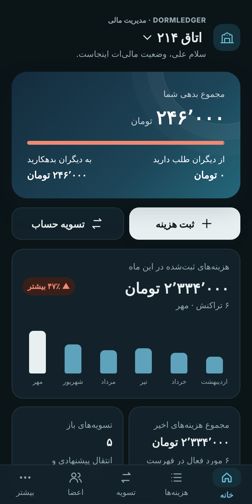<br><sub><b>Home</b><br>your balance, this month</sub></td>
    <td align="center" width="25%">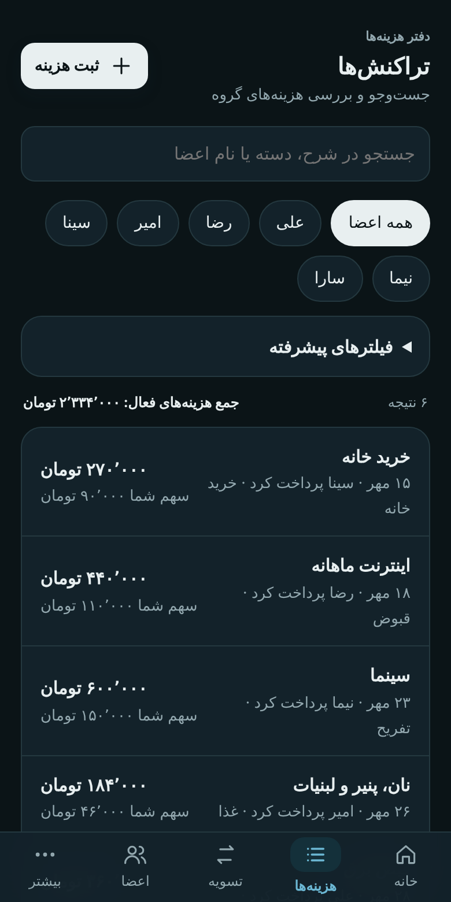<br><sub><b>Expenses</b><br>search, filters, categories</sub></td>
    <td align="center" width="25%">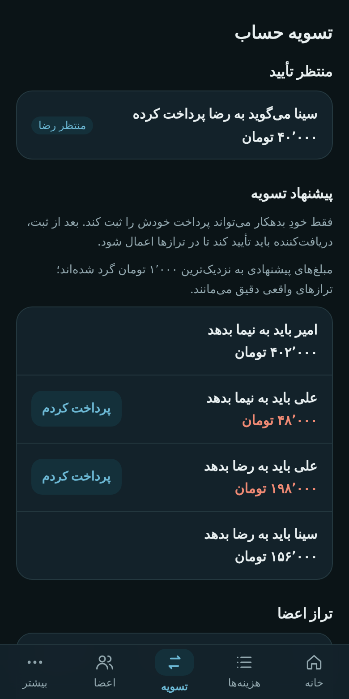<br><sub><b>Settle up</b><br>the fewest transfers</sub></td>
    <td align="center" width="25%">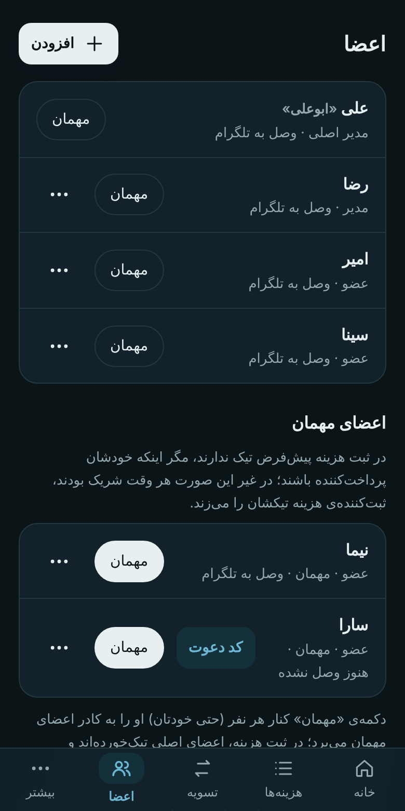<br><sub><b>Members</b><br>main and guest members</sub></td>
  </tr>
  <tr>
    <td align="center">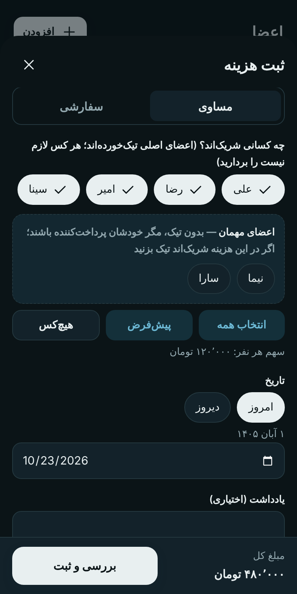<br><sub><b>New expense</b><br>guests are in their own box, unticked</sub></td>
    <td align="center">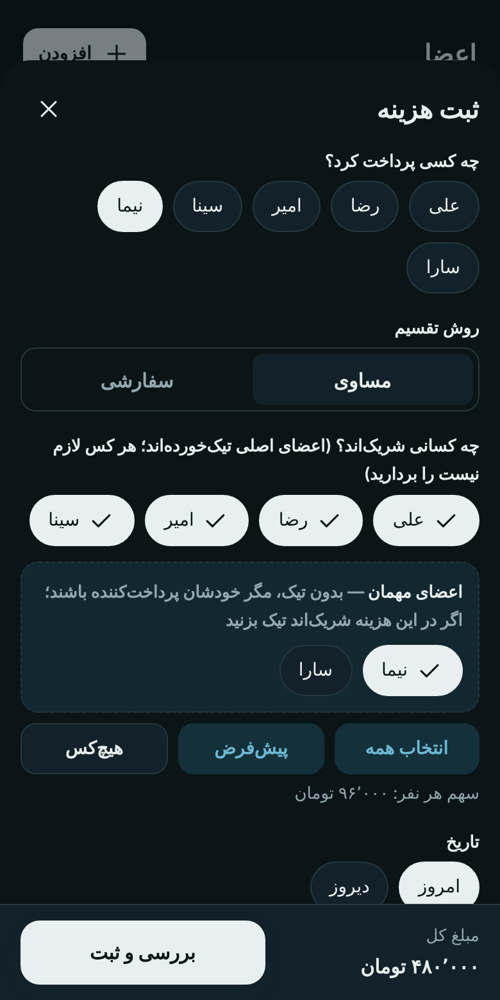<br><sub><b>A guest paid</b><br>so the guest is ticked automatically</sub></td>
    <td align="center">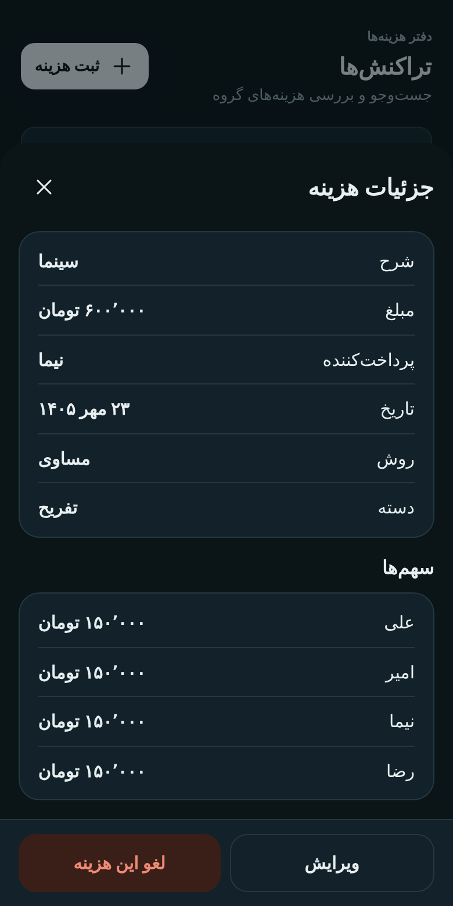<br><sub><b>Details</b><br>who paid, who shares what</sub></td>
    <td></td>
  </tr>
</table>

### The bot chat

<table>
  <tr>
    <td align="center" width="25%" valign="top">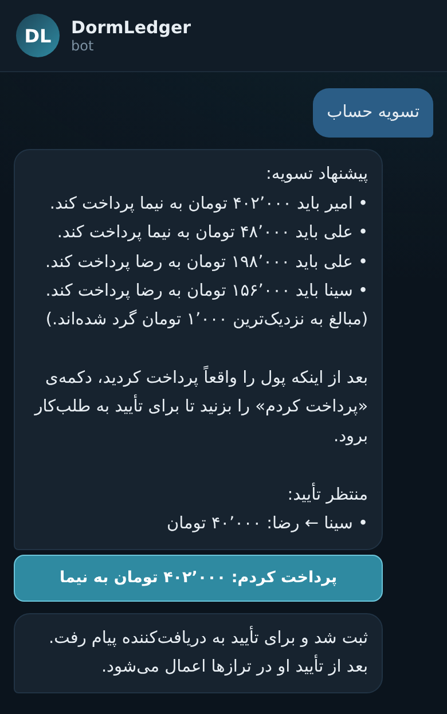<br><sub><b>«تسویه حساب»</b><br>suggestions and a "I paid" button</sub></td>
    <td align="center" width="25%" valign="top">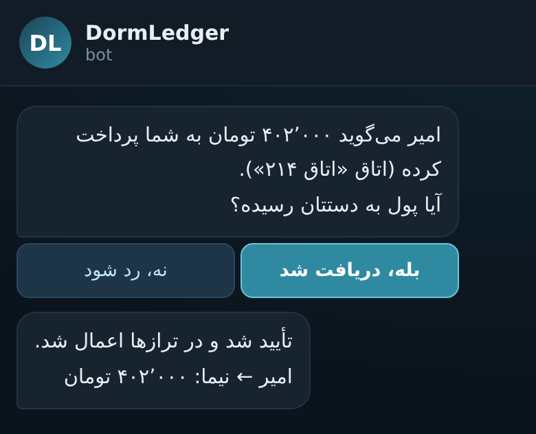<br><sub><b>The creditor confirms</b><br>one tap</sub></td>
    <td align="center" width="25%" valign="top">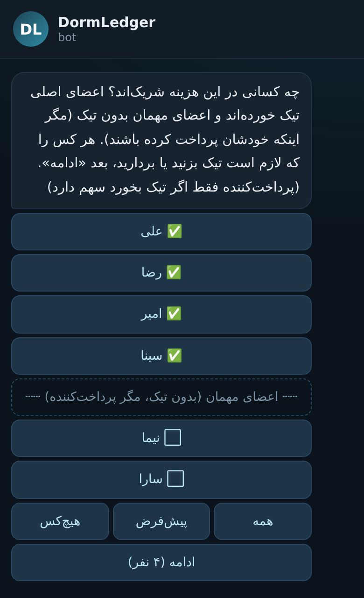<br><sub><b>«ثبت هزینه»</b><br>main members ticked, guests apart</sub></td>
    <td align="center" width="25%" valign="top">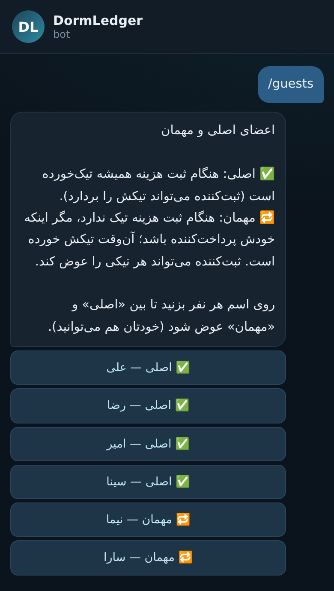<br><sub><b>/guests</b><br>an admin picks the guests</sub></td>
  </tr>
</table>

<sub>All screenshots are rendered from the real UI and the real bot code with invented people and amounts (no real data). To regenerate them see [Development](#development).</sub>

## Guest members

Some people are only around now and then. Marking them as **guests** keeps them out of the default selection, so the common case - splitting between the people who live there - needs no unticking.

- An admin (or the owner) marks any active member as a guest - **including themself** - with the «مهمان» chip in the Members tab, or with `/guests` in the bot. Tap again to make the person a main member.
- When an expense is added, **main members are ticked** and **guests sit in a separate box, unticked**.
- Exception: **a guest who is the payer is ticked automatically** (if they paid, they are part of it).
- Whoever records the expense can still tick or untick anyone - it is only the *default*.
- It never changes balances or existing expenses.

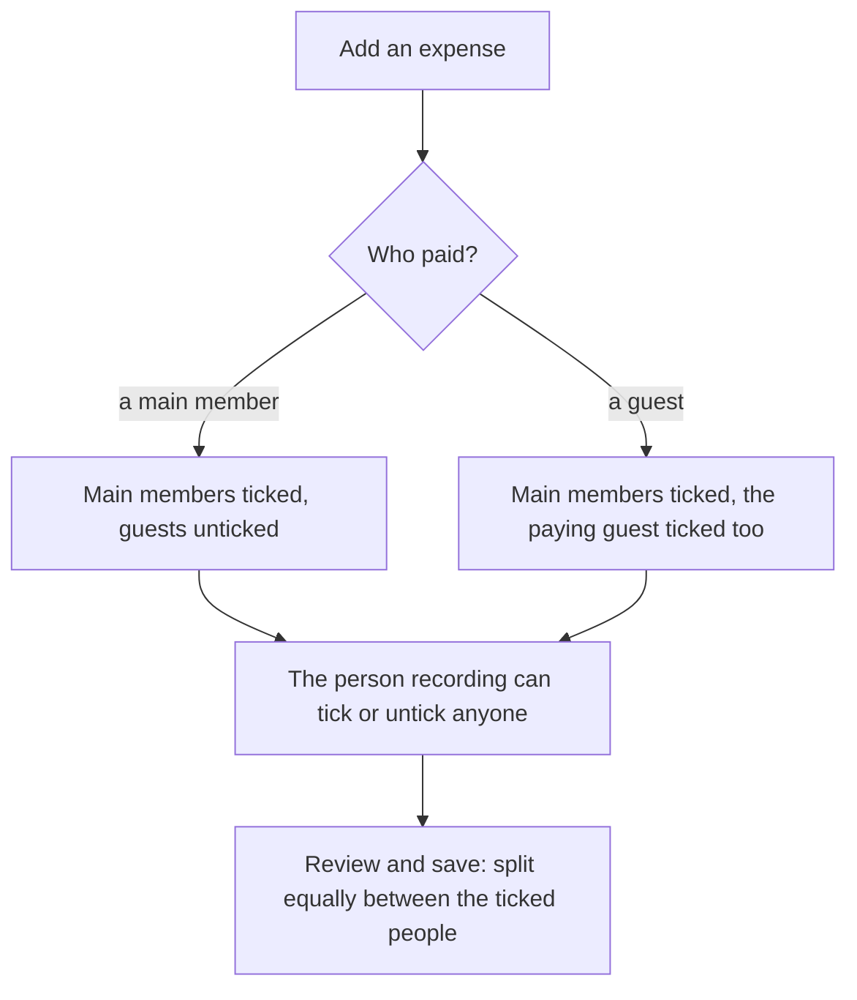

## Settling up in the chat

The person who owes presses the button themself, so nobody can record a payment for someone else. If the person who is owed has not linked Telegram yet, an admin can confirm or reject on their behalf.

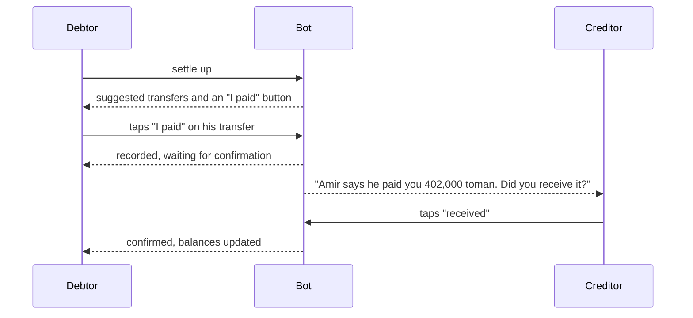

## Deploy by hand (any OS)

You need a [Cloudflare](https://dash.cloudflare.com) account (free), a Telegram account and [Node.js](https://nodejs.org) 22.13+.

```bash
git clone https://github.com/alireza-yahyae/dormledger.git
cd dormledger
npm install
npx wrangler login
```

1. **Create the bot** - talk to [@BotFather](https://t.me/BotFather), send `/newbot`, keep the token.
2. **Create the database** - `npx wrangler d1 create dormledger` and copy the printed `database_id`.
3. **Configure** - copy `wrangler.example.jsonc` to `wrangler.jsonc` and fill in `database_id` and `APP_URL` (`https://dormledger.<your-subdomain>.workers.dev`).
4. **Create the tables** - `npm run migrate:remote`
5. **Set the secrets**
   ```bash
   npx wrangler secret put BOT_TOKEN        # token from BotFather
   npx wrangler secret put WEBHOOK_SECRET   # any long random string
   ```
6. **Deploy** - `npm run deploy`
7. **Connect Telegram** - open once in a browser (it sets the webhook, menu button and command list):
   ```
   https://dormledger.<your-subdomain>.workers.dev/setup?key=<WEBHOOK_SECRET>
   ```
8. Open your bot, send `/start`, tap **🚀 باز کردن DormLedger**.

> The Mini App only works from inside Telegram - it needs Telegram's signed `initData` to know who you are.

**Updating by hand:** `git pull && npm install`, then `npm run migrate:remote` (applies only new migrations), `npm run deploy`, and open the `/setup?key=...` address once if the release added bot commands. Back up first: `npx wrangler d1 export dormledger --remote --output backup.sql` (real user data - it is git-ignored, never commit it).

## Bot commands

| Command | What it does |
|---|---|
| `/start`, `/app` | Welcome / open the Mini App |
| `/add` | Record an expense |
| `/balance`, `/settle` | Balances and suggested transfers (with the "I paid" buttons) |
| `/expenses`, `/members`, `/rooms` | Lists |
| `/guests` | Choose the guest members (admin) |
| `/addmember name` | Add a member without Telegram (admin) |
| `/invite [member]`, `/join code` | Invite code / join with a code |
| `/name`, `/nickname` | Change your display name / nickname |
| `/leave` | Leave the current room (when your balance is zero) |
| `/clearhistory`, `/restorehistory` | Clear all records / undo within 48 h (admins) |
| `/help`, `/cancel` | Help / cancel the current step |

## Backups

The daily cron (03:17 UTC) takes a backup of every data table (not the transient bot state) as a gzipped file of `INSERT` statements. Pick one or both destinations:

- **Telegram** - set `BACKUP_CHAT_ID` in `wrangler.jsonc` to *your own* numeric Telegram ID (ask [@userinfobot](https://t.me/userinfobot); you must have started the bot once; the installer can set it for you). The files arrive as documents in that chat. They contain real user data, so use a private chat only. Each day two files arrive: the restorable `.sql.gz` and a `-report.csv` spreadsheet (balances, every expense, confirmed payments) that opens in Google Sheets or Excel on a phone, with no bot needed.
- **R2 bucket** - `npx wrangler r2 bucket create dormledger-backups`, then uncomment the `r2_buckets` block in `wrangler.jsonc`. One file per day is stored, the newest `BACKUP_KEEP` (default 14) are kept.
- **Second bot (recommended)** - create another bot in @BotFather, press Start on it once, then `npx wrangler secret put BACKUP_BOT_TOKEN`. Backups are then sent by that bot, so a banned or revoked main bot does not stop them.

If a destination fails you get a warning message in Telegram. Send `/backup` to the bot from the `BACKUP_CHAT_ID` account to take one right now (the command is hidden for everyone else).

**What survives a ban?** Everything already delivered to your chat. The cron runs on Cloudflare, so if the Cloudflare account itself is suspended no *new* backups are made; at most the last day is lost. Forward the files to Telegram *Saved Messages* (independent of any bot) or keep them on your phone now and then.

**Restore:** create a database, apply the migrations, then replay the dump:

```bash
gunzip dormledger-2026-10-14.sql.gz
npx wrangler d1 create dormledger-restored      # then put its database_id in wrangler.jsonc
npx wrangler d1 migrations apply dormledger-restored --remote
npx wrangler d1 execute dormledger-restored --remote --file=dormledger-2026-10-14.sql
```

## Security and privacy

- Your data lives in **your** Cloudflare D1 database. The project talks only to Telegram and Cloudflare; the installer sends nothing anywhere else.
- Secrets (`BOT_TOKEN`, `WEBHOOK_SECRET`) are stored as Cloudflare secrets, never in the repository. `wrangler.jsonc`, `.dev.vars`, `.env*` and database exports are git-ignored, and the release helper refuses to publish them or anything that looks like a token.
- Every API call is authenticated with Telegram's signed `initData`; the webhook only accepts requests carrying your secret; money-changing calls are idempotent and recorded in an audit log.
- Found a vulnerability? See [SECURITY.md](SECURITY.md).

## FAQ / Troubleshooting

<details>
<summary><b>Does it cost anything?</b></summary>
A room of roommates uses a tiny fraction of Cloudflare's free tier (Workers + D1). You need no card for the free plan. Telegram bots are free.
</details>

<details>
<summary><b>PowerShell says "running scripts is disabled on this system"</b></summary>
That only affects a downloaded <code>.ps1</code> file. The one-line command (<code>irm ... | iex</code>) is not blocked. For a saved file use <code>powershell -ExecutionPolicy Bypass -File .\install.ps1</code>.
</details>

<details>
<summary><b>"Node.js 22.13 or newer is needed"</b></summary>
The installer offers to install the current LTS with winget. If winget is missing, install Node.js LTS from nodejs.org, open a <b>new</b> PowerShell window and run the line again.
</details>

<details>
<summary><b>Cloudflare asks for a workers.dev subdomain</b></summary>
Only the first time on a new account. Type any name; it becomes part of your app address (<code>dormledger.&lt;name&gt;.workers.dev</code>).
</details>

<details>
<summary><b>The installer could not connect Telegram ("not reachable yet")</b></summary>
A brand-new workers.dev address can take a minute to appear. Run the same line again - it only repeats the last steps and refreshes the webhook.
</details>

<details>
<summary><b>The Mini App says it must be opened from Telegram</b></summary>
That is expected in a normal browser tab. Open the bot and use the menu button or <code>/app</code>.
</details>

<details>
<summary><b>I updated but the bot menu has no <code>/guests</code></b></summary>
Run the installer line again (it refreshes the menu), or open <code>https://&lt;your-app&gt;/setup?key=&lt;WEBHOOK_SECRET&gt;</code> once if you deploy by hand.
</details>

<details>
<summary><b>How do I remove everything?</b></summary>
Inside the install folder: <code>npx wrangler delete</code> and <code>npx wrangler d1 delete dormledger</code>, then delete the folder. In Telegram, send <code>/deletebot</code> to @BotFather if you also want to remove the bot. Export your data first if you may need it.
</details>

## How it works

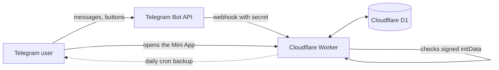

The Worker serves the Mini App (one HTML page), a small JSON API and the bot webhook. All state lives in D1. Money logic is pure functions in `src/domain/`, covered by tests including a randomized "balances always sum to zero" property test.

```
src/
  index.ts        routes: Mini App, /api/*, /webhook, /setup, cron
  api.ts          JSON API for the Mini App
  bot.ts          Telegram bot logic and notifications
  security.ts     Telegram initData validation
  backup.ts       daily SQL + CSV backup to Telegram / R2
  domain/         money, allocation, ledger, settlement (pure, tested)
  ui.ts           generated from ui/index.html  (npm run build:ui)
ui/index.html     the Mini App (single file, no build tools)
migrations/       numbered D1 migrations (never edit a released one)
scripts/          install.ps1, release_to_github.py, build-ui.mjs, screenshots/
tests/unit/       node:test suites (API, bot, UI smoke test, domain, backup)
```

## Development

```bash
npm test            # no dependencies needed: Node's built-in test runner and SQLite
npm run build:ui    # after editing ui/index.html
```

Regenerate the README pictures (needs `pip install playwright` and a Chromium for it):

```bash
node --experimental-strip-types --no-warnings scripts/screenshots/build_sample.mjs
node --experimental-strip-types --no-warnings scripts/screenshots/capture_bot.mjs
python scripts/screenshots/shoot.py
```

Publish your own copy or a new version to GitHub (browser sign-in, tag, Release; try `--dry-run` first):

```bash
python scripts/release_to_github.py --repo <you>/dormledger
```

## Contributing

Issues and pull requests are welcome - see [CONTRIBUTING.md](CONTRIBUTING.md) and the [changelog](CHANGELOG.md).

## License

[MIT](LICENSE)
